# Matriz de Skills Externas, Dependencias y Ecosistema de Ejecución
## Deep-Research Gauntlet-Loop (`deep-research-gauntlet-loop`)

Este documento especifica de forma exhaustiva todas las **skills externas de Antigravity**, **herramientas de plataforma**, **librerías de Python**, **modelos locales** y **dependencias de sistema** indispensables para ejecutar la pipeline institucional **`deep-research-gauntlet-loop`**.

---

## 1. Mapa de Integración y Flujo de Interacción

La skill `deep-research-gauntlet-loop` actúa como el **orquestador central** del análisis institucional, delegando y exigiendo el cumplimiento de estándares gobernados por otras skills y motores especializados:

```mermaid
flowchart TD
    subgraph Orquestador["Orquestador Central"]
        DRGL["deep-research-gauntlet-loop\n(Auditoría Forense y Módulos 01-18)"]
    end

    subgraph SkillsAgente["Skills Externas de Agente (Mandatarias)"]
        HUM["humanamente\n(Reescritura, Prosa Humana, P01-P32)"]
        CPPTX["claude-pptx-skills\n(Diseño OOXML, Tokens, Layout 16:9)"]
        APPTX["academic-pptx-skill\n(Estructura Dialéctica y Ghost Deck)"]
    end

    subgraph HerramientasPlataforma["Herramientas Antigravity"]
        WEB["search_web\n(Catálogo SKUs, Noticias, Consenso)"]
        SUB["invoke_subagent / send_message\n(Paralelismo Oleadas y Recuperación 429)"]
        FS["write_file / edit_file\n(Escritura de Borradores sin Templates)"]
    end

    subgraph MotoresPython["Motores Locales y Dependencias"]
        OCR["PaddleOCR / pdfplumber\n(Extracción selectiva de PDFs)"]
        YF["yfinance\n(Datos de Mercado en Vivo)"]
        CHART["matplotlib / seaborn\n(10 Gráficos 300 DPI)"]
        DOCX["python-docx\n(Informe Institucional >=27k palabras)"]
        PPTX["python-pptx\n(Deck 40/60 Slides en 7 Actos)"]
        KOK["Kokoro-ONNX + ffmpeg\n(Podcast 3 voces >=40 min)"]
    end

    DRGL --> HUM
    DRGL --> CPPTX
    DRGL --> APPTX
    DRGL --> WEB
    DRGL --> SUB
    DRGL --> FS
    DRGL --> OCR
    DRGL --> YF
    DRGL --> CHART
    DRGL --> DOCX
    DRGL --> PPTX
    DRGL --> KOK
```



---

## 2. Skills Externas del Ecosistema de Agentes

### 2.1. `humanamente` (Auditoría de Tono Humano y Estilo Institucional en Castellano)
* **Ubicación en el Workspace:** [`c:\PROJECT\Informes\.agents\skills\humanamente\SKILL.md`](file:///c:/PROJECT/Informes/.agents/skills/humanamente/SKILL.md)
* **Rol en el Pipeline:** Supervisa y audita los 4 subsistemas (`md`, `docx`, `pptx`, `podcast`). Garantiza que el texto generado carezca de los vicios y clichés típicos de los modelos de lenguaje, asegurando que la prosa suene humana, sobria y analítica.
* **Reglas Mandatarias Aplicadas en el Gauntlet:**
  * **P17 (Action Titles en Sentence Case):** En presentaciones PPTX, los títulos de las diapositivas deben ir en minúsculas salvo la primera letra y nombres propios (prohibido el *Title Case* anglosajón).
  * **P14 (Cero Rayas Inglesas Espaciadas):** Prohibido el uso de la raya con espacios (` — `) en títulos o viñetas; uso exclusivo de coma, dos puntos o paréntesis.
  * **P19 (Comillas Latinas):** Uso estricto de comillas angulares latinas (`« »`); prohibidas las comillas curvas inglesas (`“ ”`).
  * **P03 / P22 (Cero Gerundios de Consecuencia):** Prohibido el gerundio tras coma que denota resultado o efecto (ej. `, demostrando`, `, permitiendo`, `, asegurando`).
  * **P09 (Cero Paralelismos Negativos):** Eliminación de estructuras retóricas mecánicas como `no solo X, sino también Y`.
  * **P18 (Cero Emojis):** Prohibido el uso de emoticonos o iconos decorativos en informes, presentaciones y guiones.
  * **P07, P24, P26 (Cero Vocabulario y Clichés de IA):** Prohibición de términos comodín como *profundizar*, *fomentar*, *el panorama*, *un sinfín de*, *cabe destacar* o *en la era digital*.
* **Mecanismo de Verificación:** `humanamente_gate.py` ejecuta una auditoría de 3 pasadas y registra la rúbrica aprobada (mínimo 42/60 puntos) en `gauntlet_logs/humanamente_audit.json`.

---

### 2.2. `claude-pptx-skills` (Arquitectura Visual y Conformance OOXML)
* **Ubicación en el Workspace:** [`c:\PROJECT\Informes\.agents\skills\claude-pptx-skills\SKILL.md`](file:///c:/PROJECT/Informes/.agents/skills/claude-pptx-skills/SKILL.md)
* **Rol en el Pipeline:** Establece el estándar de ingeniería para la compilación de la presentación PowerPoint institucional (`*_PRESENTACION_COMITE_*.pptx`).
* **Estándares Aplicados:**
  * **Lienzo Panorámico:** Ratio 16:9 exacto (`13.333 x 7.50` pulgadas / `1280 x 720` pt).
  * **Tokens Semánticos de Color (Brand Hierarchy):**
    * *Primary Dark:* Navy Profundo (`#0A192F` / `#0D1B2A`).
    * *Secondary Accent:* Royal Blue (`#1E3A8A` / `#2563EB`).
    * *Background Canvas:* Blanco Puro (`#FFFFFF`) con tarjetas en gris suave (`#F8FAFC`).
    * *Borders:* Borde fino institucional (`#E2E8F0` / `#CBD5E1`).
    * *Status Colors:* Gold (`#D97706`), Green (`#059669`), Red (`#DC2626`).
  * **Arquitectura de Contenedores y Tarjetas:**
    * Eliminación del radio de curvatura por defecto en rectángulos redondeados altos (`adjustments[0] <= 0.14`) para evitar deformaciones ovaladas.
    * Márgenes de seguridad contra desbordamiento: ningún elemento puede superar `13.45 in` de ancho o `7.60 in` de alto.
  * **Tablas McKinsey:** Cabecera en azul marino oscuro con texto blanco en negrita, filas alternas cebradas y alineación matemática a la derecha para cifras financieras.
  * **Validación OOXML:** Chequeo estricto del archivo ZIP y de los esquemas XML (`[Content_Types].xml`, `_rels/.rels`, `ppt/presentation.xml`).

---

### 2.3. `academic-pptx-skill` (Estructura Argumentativa y Conducción Dialéctica)
* **Ubicación en el Workspace:** [`c:\PROJECT\Informes\.agents\skills\academic-pptx-skill\SKILL.md`](file:///c:/PROJECT/Informes/.agents/skills/academic-pptx-skill\SKILL.md)
* **Rol en el Pipeline:** Aporta la metodología de razonamiento y diseño de argumentos para presentaciones sometidas a comités de evaluación rigurosa.
* **Estándares Aplicados:**
  * **Hilo Conductor Secuencial:** Los *Action Titles* de las diapositivas deben formular tesis completas con sujeto, verbo y predicado que cuenten la historia de forma lineal si se leen sucesivamente.
  * **Densidad de Evidencia Primaria:** Exige que un mínimo de 20 diapositivas contengan tablas estructuradas o gráficos a 300 DPI, prohibiendo presentaciones consistentes únicamente en texto genérico.
  * **Ghost Deck Testing:** Verificación previa de que cada diapositiva responde a una objeción o pregunta concreta que plantearía un gestor de cartera escéptico.

---

## 3. Herramientas Nativas de Antigravity Requeridas

| Herramienta | Utilidad en `deep-research-gauntlet-loop` |
| :--- | :--- |
| **`search_web`** | Extracción activa en Internet de: catálogo comercial exhaustivo de productos/SKUs, noticias recientes (2025–2026), cotizaciones spot, múltiplos en vivo y consenso sell-side. |
| **`invoke_subagent`** | Lanzamiento de oleadas paralelas de subagentes (`TypeName="self"`, `Model="inherit"`) para procesar múltiples empresas de forma concurrente sin contaminar el contexto principal. |
| **`send_message`** | Reanudación y reconexión con subagentes en estado de error por cuota (`429 RESOURCE_EXHAUSTED`) o timeouts, preservando el progreso en disco. |
| **`write_file` / `edit_file`** | Redacción directa de los 4 borradores y el informe maestro sin usar plantillas de texto en Python. |
| **`run_command`** | Ejecución en PowerShell de los motores del pipeline (`prepare_company_ocr_and_market.py`, `generate_10_charts.py`, `build_institutional_docx.py`, `build_institutional_pptx.py`, `build_podcast_kokoro.py` y `gauntlet_gatekeeper.py`). |

---

## 4. Dependencias del Entorno Técnico (Python y Binarios de Sistema)

### 4.1. Librerías de Python (`requirements.txt`)

Para asegurar la ejecución determinista de todos los motores del skill, el entorno debe contar con los siguientes paquetes:

```text
# Extracción de PDFs y OCR
pypdf>=4.0.0
pdfplumber>=0.10.0
paddleocr>=2.7.0
paddlepaddle>=2.6.0

# Datos de Mercado y Finanzas
yfinance>=0.2.35
requests>=2.31.0

# Visualización y Gráficos Institucionales a 300 DPI
matplotlib>=3.8.0
seaborn>=0.13.0
pandas>=2.1.0
numpy>=1.26.0

# Compilación de Documentos y Presentaciones
python-docx>=1.1.0
python-pptx>=0.6.23
openpyxl>=3.1.2

# Motor Acústico de Audio y Podcast
kokoro-onnx>=0.3.0
onnxruntime>=1.17.0
soundfile>=0.12.1
pydub>=0.25.1
scipy>=1.11.0

# Automatización y Control Visual (Windows)
pywin32>=306
```

### 4.2. Binarios del Sistema y Modelos Locales

1. **FFmpeg (`ffmpeg` y `ffprobe`):**
   * Indispensable en el `PATH` del sistema para que `pydub` pueda ensamblar los segmentos de audio y exportar el archivo final comprimido en formato MP3 (`*_PODCAST_COMITE.mp3`), eliminando el archivo temporal WAV.
2. **Modelos Acústicos de Kokoro-ONNX:**
   * Ubicación requerida: `ROOT_DIR/_shared_engine/kokoro_models/` (o descubrimiento automático en caché).
   * Archivos necesarios:
     * `kokoro-v1.0.onnx` (pesos del modelo de síntesis).
     * `voices-v1.0.bin` (vectores de voz para los locutores `DIRECTOR`, `ELENA` y `MARCOS`).
3. **Microsoft PowerPoint (Opcional para Exportación de Control):**
   * En entornos Windows, la automatización COM mediante `pywin32` permite exportar diapositivas a PNG a 1080p para realizar verificaciones visuales de layout.

---

## 5. Resumen de Motores Compartidos (`ROOT_DIR/_shared_engine/`)

Los siguientes scripts conforman el núcleo de ejecución local del skill y deben propagarse al directorio compartido y a las subcarpetas de empresa:

| Script | Función Principal | Dependencias Clave |
| :--- | :--- | :--- |
| **`prepare_company_ocr_and_market.py`** | Filtra PDFs (100% Anuales/Intermedios + último Trimestral), ejecuta OCR y descarga datos de mercado. | `pdfplumber`, `yfinance`, `paddleocr` |
| **`generate_10_charts.py`** | Genera los 10 gráficos institucionales a 300 DPI separando datos históricos de proyecciones futuras. | `matplotlib`, `seaborn`, `company_financial_model.json` |
| **`build_institutional_docx.py`** | Compila en segundos el informe completo en formato Word (`.docx >= 27.000 palabras`) con estilos y gráficos. | `python-docx`, `*_INFORME_COMITE_FINAL.md` |
| **`build_institutional_pptx.py`** | Compila la presentación 16:9 (40 o 60 diapositivas) integrando gráficos, tablas McKinsey y diseño editorial. | `python-pptx`, `slides_deck.json` |
| **`build_podcast_kokoro.py`** | Sintetiza el podcast a 3 voces a partir del guion (`.mp3 >= 40 min / 2.400 s`) y borra el WAV residual. | `kokoro-onnx`, `soundfile`, `pydub`, `ffmpeg` |
| **`build_global_portfolio_summary.py`**| Compila el resumen comparativo de todas las empresas analizadas en Markdown y Excel con *freeze panes*. | `openpyxl`, `company_financial_model.json` |
| **`gauntlet_gatekeeper.py`** | Validador exhaustivo que audita los 4 entregables y devuelve `EXIT 0` únicamente si todo cumple el estándar. | `humanamente_gate.py`, paquetes OOXML |
| **`humanamente_gate.py`** | Motor de 3 pasadas lingüísticas que verifica la eliminación de tics de IA y califica la calidad del texto. | Expresiones regulares institucionales |

---

## 6. Procedimiento Rápido de Verificación del Entorno

Para comprobar que el entorno dispone de todas las herramientas y librerías requeridas antes de lanzar la pipeline, ejecute en la consola de comandos:

```powershell
# 1. Comprobar instalación de librerías Python críticas
python -c "import docx, pptx, openpyxl, yfinance, matplotlib, kokoro_onnx, pydub, soundfile; print('>>> TODAS LAS LIBRERÍAS DE PYTHON ESTÁN DISPONIBLES')"

# 2. Comprobar presencia de FFmpeg en el sistema
ffmpeg -version

# 3. Validar presencia de las skills en el directorio .agents
Get-ChildItem "c:\PROJECT\Informes\.agents\skills" | Select-Object Name
```
